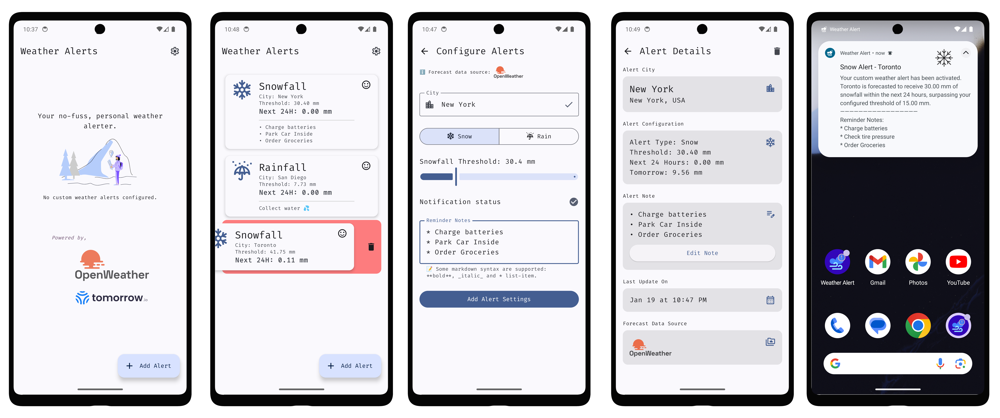
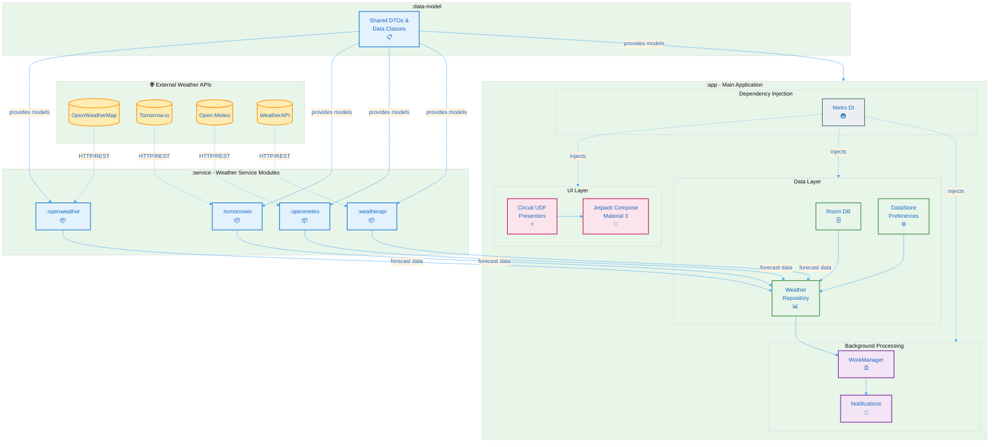

  

# Android - Weather Alert
A simple app to alert you about specific weather condition based on your configured threshold.

> [!NOTE]  
> _The app has been co-created with the help of GitHub Copilot, ChatGPT and Google Gemini._ 🤖

This app helps you to prepare for weather conditions like snow and rain, for example if there would be heavy snow ❄️ 
this will allow you charge your snow blower batteries, put car in the garage, and other related activities.

> _This app is a result from personal need to have focused alert compared to all existing apps available in the Play Store._

### **App Summary**  
**Set it and forget it — get alerted when it matters!**  

Weather Alert is a simple, no-frills app designed to notify you when specific weather conditions meet the thresholds you set. Whether it’s a snowy driveway or a rainy day, stay ahead with timely alerts that help you prepare with ease.  

🎨 Key App Features

🌨 **Custom Alerts for Specific Weather Conditions:**  
Set thresholds for snowfall or rainfall (e.g., 5cm snow, 10mm rain) and receive notifications only when they’re met.  

🌐 **Choose Your Data Source:**  
Pick between **OpenWeatherMap**, **Tomorrow.io**, **OpenMeteo**, and **WeatherAPI** for reliable and accurate forecasts.  

🔑 **Add Your Own API Key:**  
Ensure uninterrupted service by using your own API key for weather data.  

⏰ **Set Your Alert Frequency:**  
Control how often the app checks for weather updates—every 6, 12, or 18 hours—so you get timely notifications without unnecessary checks.  

📲 **Rich Notifications:**  
Receive simple, clear notifications with all the details you need to take action.  

🛠 **Minimalist Interface:**  
Easily configure and view your alerts in a simple, intuitive tile-based design.  

♿ **Accessible Design:**  
Full TalkBack screen reader support with proper content descriptions and semantic properties for visually impaired users. See [Accessibility Documentation](docs/ACCESSIBILITY.md) for details.

**Why Choose Weather Alert?**  
- Focused on delivering only what you need: alerts that meet your criteria.  
- Lightweight and efficient, with no unnecessary extras.  
- Built for people who want actionable weather notifications, hassle-free.  
- Designed with accessibility in mind for all users.  

Try out **Weather Alert** today and let the app do the work for you!  

## Developer Portal 🔧

For developers and QA engineers, the app includes a comprehensive **Developer Portal** available exclusively in internal debug builds. This portal provides powerful testing and debugging tools to accelerate development and testing workflows.

**Available Tools:**
- 🔔 **Notification Tester** - Test alert notifications without real weather
- ⚙️ **WorkManager Tester** - Manually trigger background workers
- 📋 **Alert Simulator** - Create test alerts with quick presets
- 📜 **History Simulator** - Generate historical alert data
- 🗄️ **Database Inspector** - View and export database state
- ⚙️ **State Management** - Reset preferences and app state

**Access**: Navigate to About Screen → "🔧 Developer Portal" (internal builds only)

**Documentation**: See [`docs/developer-portal.md`](docs/developer-portal.md) for comprehensive guide including:
- How to access and use each tool
- Testing workflows and best practices
- Troubleshooting common issues
- Architecture and code patterns

**Note**: The Developer Portal is **not included** in production builds and is only available in `internalDebug` build variants.

## AI Automation 🤖

This repository uses [JetBrains Junie](https://github.com/JetBrains/junie-github-action) powered by OpenRouter for automated PR code reviews and interactive issue/PR assistance. See [`docs/JUNIE_AUTOMATION.md`](docs/JUNIE_AUTOMATION.md) for full setup and usage details.

## Tech Stack 📱
Simple application generated from Android App template that uses:
* Jetpack Compose
* ⚡️ Circuit - UDF Architecture
* Jetpack libraries like - Room, Datastore, Material 3, and so on
* 🚇 Metro for dependency injection
* ... and few more. See [`libs.versions.toml`](https://github.com/hossain-khan/android-weather-alert/blob/main/gradle/libs.versions.toml) to get more idea.

Here is a diagram of Gradle modules and architecture for this app.

